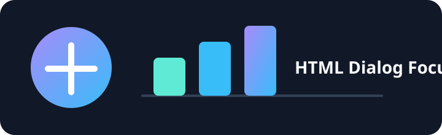

## 🔎 Overview
Compare modal and non-modal HTMLDialogElement behavior, watch lifecycle events, and inspect where keyboard focus returns.

## ✨ Features
- 🪟 Opens the same dialog with showModal() or show()
- ⌨️ Logs cancel and close events plus the dialog returnValue
- 🎯 Records the opener and demonstrates focus restoration after closing
- 📚 Runs entirely in the local browser without external requests

## 🎬 Demo
No hosted demo is published. Run the project locally using the Quick Start command below.

## 🚀 Quick Start
    npm install && npm start

## 🧰 Tech Stack
- Node.js 18+
- Native HTMLDialogElement
- Vanilla JavaScript and CSS

## 🗂️ Folder Structure
    server.js              Dependency-free local static server
    public/index.html      Dialog controls and demo markup
    public/app.js          Event and focus instrumentation
    public/style.css      Responsive dark interface

## 🛣️ Roadmap
- [ ] Add a nested-dialog behavior note
- [ ] Add a keyboard-only walkthrough

## 🤝 Contributing
Issues and pull requests are welcome. Keep changes focused, document behavior, and add a small reproducible example for new features.

## 📄 License
Released under the MIT License. See LICENSE.

